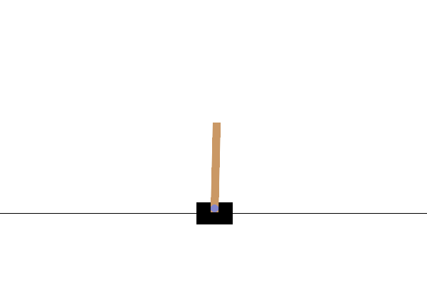
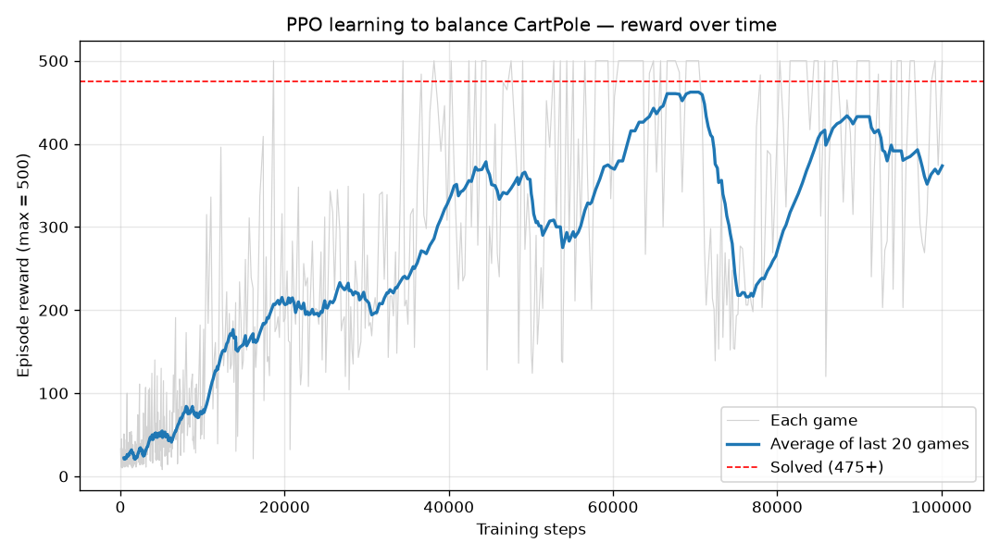

# PPO on CartPole

A PPO (Proximal Policy Optimization) agent learns to balance a pole on a cart, using
[Stable-Baselines3](https://stable-baselines3.readthedocs.io/) and
[Gymnasium](https://gymnasium.farama.org/) `CartPole-v1`. Trained on CPU only.



## Result

| | Mean reward (max 500) |
|---|---|
| Random policy | 9 – 32 |
| PPO, 200k steps | **485.4** over 20 deterministic evaluation episodes |

CartPole-v1 counts as solved at an average of 475.



## What `ppo.py` does

1. Builds the environment (wrapped in `Monitor` + `DummyVecEnv`)
2. Trains PPO (`MlpPolicy`, lr 3e-4, n_steps 1024, batch 256, gamma 0.99, seed 42)
3. Records every episode's reward with a custom callback and plots the learning curve
4. Evaluates the trained policy on 20 fresh episodes (deterministic actions)
5. Renders one episode as `trained_agent.gif` and saves the model to `ppo_cartpole.zip`

```bash
pip install stable-baselines3 gymnasium matplotlib pillow
python ppo.py                          # 200k steps
RL_DEMO_TIMESTEPS=50000 python ppo.py  # quicker run
```

## `exercises/`

My step-by-step warm-up before the full script:

- `rl.py`: look at the observation/action spaces and play with a random policy (scores 9–32)
- `brain.py`: train PPO for 50k steps (mean episode reward went 23 → 393) and save it
- `watch.py`: load the saved model and watch it play

## Next

Continuous control (MuJoCo), then a quadruped gait, working toward a robot dog climbing stairs.
